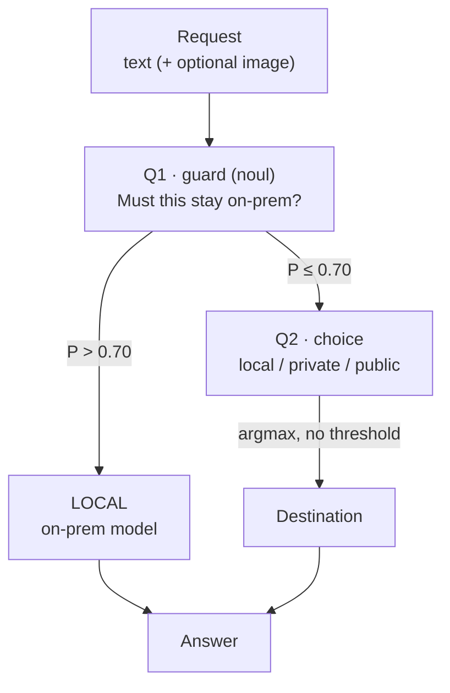

> **Note on this copy:** this is the portfolio write-up. The trained weights, checkpoints, evaluation data and reproduction scripts are not published in this repo — see the README for what is and is not included.

# Confidentiality-Aware Request Router

**A small decision model that decides where an AI request is allowed to run: on-prem, private cloud, or a public API.**

Portfolio write-up · 2026 · `strands-decider` 2B + LoRA · NVIDIA 8 GB GPU

---

## At a glance

| | |
|---|---|
| **Problem** | Every request sent to an AI system has to land on one of three trust boundaries: a machine that never lets data out, the company's own cloud, or an external model API. Getting it wrong in one direction leaks data; getting it wrong in the other burns money and capacity. |
| **Approach** | Fine-tune a 2B "decision model" — not an LLM, a classifier that scores options — into a two-question policy: a yes/no sensitivity guard, then a three-way destination choice. |
| **Headline result** | **90.0% exact destination** — and **0 of 25 high-sensitivity requests reached a public API** — on an 80-case holdout written after the model was frozen. |
| **Cost** | 1–2 forward passes per request, no text generation · 115.8 ms p50 / 126.6 ms p95 · ~4.5 GB VRAM · 202 MB adapter on a 4.3 GB base model. |
| **Honest caveat** | Calibration error 0.143 against a 0.10 target, and 3 of the 30 internal requests still reached the external API. The system is a strong filter with a human/policy backstop — not a guarantee. |

**What makes it worth reading:** the model is the easy part. The work was in building an evaluation harness honest enough to keep proving the project wrong, generating training data that generalises past its author's imagination, and recognising when the remaining gap was a *problem-framing* problem rather than a training problem.

---

## 1. The problem

A company running AI assistants has more than one place to run a model:

- **on-prem** — the only place certain content is allowed to go;
- **private cloud (AWS)** — fine for internal material, not for anything customer-facing;
- **public API** — cheap, capable, and completely outside the company's control.

Today a human decides, or a regex list does. Neither scales. The classifier that should replace them has awkward requirements:

1. **It must be cheap and fast** — it runs on *every* request, before the expensive model does.
2. **It must be calibrated**, because the decision is asymmetric: a false "local" costs capacity, a missed "local" costs confidentiality.
3. **It must not be an LLM**, because sending the request to an LLM to ask whether the request is safe to send to an LLM is circular.
4. **Its labels must be changeable without retraining**, because the taxonomy was explicitly allowed to change while the surrounding services were still being chosen.

That combination is exactly the gap that "decision models" — small models that pick among options and rate things on a scale — are meant to fill.

---

## 2. What I built

A full adaptation loop around an open-source decision model, ending in a deployable service and a reproducible handover package: evaluation harness, synthetic data pipeline, thirteen numbered training runs, a decision policy with a single fitted threshold, and a set of scripts that reproduce every published number.



Two properties matter:

- **The guard is the safety control.** One fitted number in the entire policy (0.70) decides whether a request is forced on-prem. It is deliberately set a wide margin below the lowest high-sensitivity score ever observed (0.815).
- **The second question has no threshold.** Once a request is cleared, the three-way argmax decides. That was a design choice: a second threshold would be a second knob to fit and defend, and adding one was never justified by the data.

Worst case is two model calls; the common case for sensitive traffic is one.

---

## 3. How it works

### 3.1 The model is not an LLM

The base is Qwen3.5-2B, but its **language-modelling head is removed**. What remains is the torso, plus a small **pointer head** that turns a question into a distribution over options:

```
prompt  =
  <state>   the request text
  <question type="choice">
     instructions
     1. local   — description
     2. private — description
     3. public  — description
  </question>
  <answer>
```

One forward pass. The hidden state at the `<answer>` position is the query; the hidden state at the last token of each option is a key. Scaled dot product, softmax, done:

```python
logit_k = <q(h_answer), k(h_option_k)> / sqrt(dim)
```

Consequences that turned out to matter for this project:

- **No generation, no decoding loop.** Latency is one forward pass, not one token at a time.
- **No per-option parameters.** Nothing can learn "the first option is usually right", and there is no ceiling on how many options a question may carry. Labels are defined *in the request*, so a taxonomy can change without retraining — the property the project needed most.
- **Confidence is derived, not predicted**: `confidence = (N·p_max − 1) / (N − 1)`, which is independent of `N` so one threshold means the same thing for 3 options and 12.

The trained artifact is a **rank-48 LoRA adapter** (alpha 96, dropout 0.05) across 12 projection modules, plus the head. The base weights are frozen; the frozen base is fetched from Hugging Face at load time. The delivered adapter is 202 MB against a 4.3 GB base.

### 3.2 The policy, in full

```python
p = model.noul(state, GUARD_QUESTION)
dest = "local" if p > 0.70 else model.choice(state, DESTINATION_QUESTION, criteria)
```

That is the entire deployment logic. Two constants are coupled and must move together:

- `temperature = 3.3178` is fitted into the checkpoint config;
- `guard threshold = 0.70` was fitted against that temperature.

Reset the temperature to 1.0 and the threshold is meaningless. This is documented as a hard rule in the handover because it is the single easiest way to silently break the system.

### 3.3 The API

The runtime exposes the model as a small HTTP service, so the harness only sees a JSON contract:

```json
POST /v1/systemone
{
  "state": "Explain why October revenue landed at £1.74m against the unpublished £1.96m forecast",
  "questions": {
    "q": {
      "type": "choice",
      "instructions": "Which destination should serve this request? ...",
      "criteria": {
        "local":   "Must never leave the company ...",
        "private": "Fine inside our own cloud (AWS) but not for an external model ...",
        "public":  "Safe to send to an external model ..."
      }
    }
  }
}
```

A `choice` question takes `criteria` (label → description), not `options`; sending `options` returns HTTP 422. That distinction cost real time and is now the first line of the handover's gotcha list.

---

## 4. Data

### 4.1 Labels

Three destinations, each with a written definition that ships with every request — the model sees the same rubric a human would:

| Label | Definition used in the prompt |
|---|---|
| `local` | Must never leave the company — personal data about identified people, credentials, legal or medical matters, or unpublished financial figures. |
| `private` | Fine inside our own cloud (AWS) but not for an external model — internal drafts, plans, notes, client-specific material. |
| `public` | Safe to send to an external model — already published, or entirely generic. |

Earlier in the project the task was a **six-route** router (formatting, coding, reasoning, image analysis, doc transformation, local). That taxonomy was dropped when it became clear the team's real requirement was a *trust boundary*, not a task type — and the three-way framing is what finally produced a defensible number. Discovering that the problem statement was wrong was worth more than any hyperparameter.

### 4.2 Training data: composition instead of enumeration

No labelled production traffic was available, so the data was synthesised — but not by writing thousands of sentences by hand. The pipeline **composed** rows:

- **~48 sensitive/benign pairs** in the same domain and often the same verb ("fix the connection string in this config" vs "fix the indentation in this config");
- **× 12 verbs × 5 prefixes × 5 suffixes**, deduplicated → ~3,900 rows over ~2,700 distinct phrasings;
- **eight departments** (creative, finance, HR, legal, sales, ops, medical, engineering), because the customers were other departments and a single-department vocabulary was too narrow;
- **three payload shapes** — document nouns, field-level records (`first_name`, `dob`, `address`), and credential-shaped strings (`postgres://admin:…`, `Authorization: Bearer eyJ…`);
- **vocabulary randomisation during training** — label names, descriptions, instruction wording, option count (6 or 16) and input format all varied per row, so the model could not bind to one vocabulary.

The matched-pair construction is the important part. Every sensitive prompt has a harmless lookalike that shares its domain, its verb, and often its noun — so "mentions money" or "mentions a client" is never enough. The model has to use the content.

### 4.3 Evaluation sets

Nothing in this project was judged on data it had been tuned against.

| Set | Size | Role |
|---|---|---|
| **Frozen holdout** | 80 | **The number to quote.** 25 `high`, 30 `some`, 25 `none`; written by an independent generator after the model was frozen. Zero prompts matched the training corpus or any earlier test set at ≥0.80 similarity. |
| Tuned benchmark | 108 | 40 sensitive, 18 image, 10 long-document cases. Used repeatedly for selection, so it is **no longer a holdout** — kept as a regression check only. |
| Tuning set | 101 | Used to choose between designs and fit the 0.70 threshold. |
| Generated batch 1 | 50 | Written by a different generator to a brief; frozen, never trained on. |
| Blind test set | 50 | Written by an outside generator from a test-set brief; used to settle the gate-vs-router question. |
| Fresh generic set | 59 | Written after all tuning: 37 ordinary, 12 implicit-sensitive, 10 explicit. |
| Creative holdout | 270 | Disjoint creative-agency vocabulary; used for in-domain depth. |

### 4.4 Contamination control

Before any training run, new prompts were checked for overlap against every prior dataset at ≥0.80 similarity. **That check caught two contaminated runs** — both would otherwise have produced a flattering, meaningless number. It is now a gate in the training pipeline, not an afterthought.

---

## 5. Results

### 5.1 Headline

Measured on the 80-case frozen holdout, two-question policy, threshold 0.70:

| Metric | Result |
|---|---|
| **Exact destination** | **90.0%** (72/80) |
| high tier → `local` | **96.0%** (24/25) |
| some tier → `private` | 83.3% (25/30) |
| none tier → `public` | 92.0% (23/25) |
| **Sensitive content reaching a public API** | **0** |
| Sensitive content reaching private cloud | 1 |
| Internal content reaching a public API | 3 |
| Calibration (ECE, guard) | 0.143 |
| Latency p50 / p95 | 115.8 / 126.6 ms (model time 101.9 / 116.9 ms) |
| Fitted thresholds in the policy | 1 |

The error structure is the interesting part. Eight misses, and they are not spread evenly:

| Error | Count | Read |
|---|---|---|
| high → private | 1 | **The dangerous direction was empty.** The one high-tier miss stayed inside the company. |
| some → public | 3 | Internal drafts cleared for an external model — the boundary failing, not a leak. |
| some → local | 2 | Over-conservative; costs capacity, not confidentiality. |
| none → private/local | 2 | Over-conservative. |

**Every error was in the safe direction or adjacent to it.** The single high-tier miss was still contained inside the company.

### 5.2 What actually moved accuracy

| Intervention | Effect | Verdict |
|---|---|---|
| Upgrade the released model (v19 → v1) | +6.5 pts | **Not distinguishable** (McNemar p = 0.143) |
| Reword one option description | **+12 pts** | **Real** (p = 0.001) |
| Add vision to a text-tuned model | 8/8 images, incl. both sensitive ones | Real, with no image training |
| Rename labels, keep descriptions | −10 pts sensitivity | Real — the literal token "local" was doing work |
| Go from 6 to 24 options | −24 pts accuracy | Real — option count costs accuracy |
| Narrow the task from 6 routes to 3 destinations | Made the leak metric directly measurable; one threshold instead of a six-way argmax | Decisive for deployment, not for the benchmark |

The rewording result is the one I quote most: **better prompt text beat a better model**, and the only way to know that was to test both on the same cases with a paired test. Bare percentages would have let the model upgrade take credit for the prompt fix.

### 5.3 The result that mattered most

Mid-project, the router scored **95% sensitivity (98.1% overall)** on the 108-case benchmark. That number had been used repeatedly to choose descriptions and pick between runs. So I wrote 59 brand-new cases and ran the same checkpoint on them untouched:

| Slice | Tuned 108-case set | **Fresh 59-case set** |
|---|---|---|
| Overall | 98.1% | **81.4%** |
| Sensitivity | 95.0% | **63.6%** |
| — implicit sensitivity | 93.3% | **41.7%** |

The model had **learned my vocabulary, not the concept**. Every implicit miss hinged on a noun that never appeared in training: SOC2 evidence, salary benchmarking, disciplinary hearing, redundancy consultation, credit committee. The 95% was an artefact of tuning against the benchmark.

That finding reset the project's direction: the binding constraint was **representative data**, not model size, hyperparameters, or policy. It also set the reporting rule used for the rest of the work — every number is quoted on a set that was written *after* the model producing it was frozen.

### 5.4 The ceiling, measured rather than guessed

Three independent lines of evidence said the same thing:

1. **Thresholding does not close the gap.** Sweeping the `local` bar from 0.25 down to 0.10 bought +4.5 pts of sensitivity for ~3 pts of ordinary accuracy, then collapsed into sending everything local. There was no operating point reaching the target with usable routing.
2. **More synthetic data stopped generalising.** Runs 5–7 sat at 86–90% sensitivity on unseen data regardless of volume; adding data rearranged errors rather than removing them.
3. **An independent generator reproduced the same band.** Fifty prompts written by a *different* model to a written brief scored 84.6% sensitivity (11/13) — not 95%. The ceiling was real, not an artefact of one author's data.

| Model | Sensitivity | Ordinary | Bias |
|---|---|---|---|
| Router, conservative | 92.3% | 67.6% | toward `local` |
| **Shipped configuration** | **84.6–90%** | **92–95%** | balanced |
| Under-trained run | 61.5% | 94.6% | too weak |

Sensitivity and routing capacity trade against each other, and no setting reaches both. The honest deliverable became **a choice of operating point on a measured curve**, not a model that meets a spec.

### 5.5 Three things that did not work

- **Sentence embeddings.** A 1,342-prompt embedding bank scored by cosine similarity reached AUC ≈ 0.66 against the model's 0.96. Structural reason: the hard negatives are same-domain, same-verb lookalikes, so similarity cannot separate them. Twenty minutes to rule out, and it never came up again.
- **A KL anchor against catastrophic forgetting.** It does not fit in 8 GB — zero optimizer steps in twenty minutes, VRAM pinned at 7,931/8,188 MiB. Balanced data replaced it.
- **Training on generated data as a garnish.** Adding 150 externally generated rows on top of a saturated checkpoint *reduced* sensitivity from 84.6% to 61.5%. Generated data has to be the basis of a run, not a top-up.

---

## 6. Engineering

### 6.1 Performance

| | |
|---|---|
| Model calls per request | 1 (guard fires) or 2 |
| Latency p50 / p95 | 115.8 / 126.6 ms wall clock |
| Model time p50 / p95 | 101.9 / 116.9 ms |
| VRAM, serving | ~4.5 GB (6 GB card minimum) |
| Adapter size | 202 MB (vs 4.3 GB base, downloaded once) |
| Trainable | LoRA adapter + pointer head only; base frozen |

The comparison that matters: this is a gate that runs on **every** request for ~100 ms on a single consumer GPU, and its answer is a probability a policy can reason about. An LLM call for the same decision would be two orders of magnitude more expensive and would still not give a calibrated number.

### 6.2 Reproducibility

The handover is built so someone else can reproduce the numbers without me in the room:

- **Runtime pinned by commit** (`b81d443…`), not version — a newer runtime changes temperature handling, prompt assembly and option tokenisation, all of which move the scores.
- **Dependencies pinned exactly** (torch 2.14.1, transformers 5.20.2, peft 0.21.2, datasets 5.1.0); `transformers` below 5.18 silently breaks image input.
- **Weights under Git LFS** with SHA-256 checksums for every binary artifact, verified on every machine move.
- **Scripts that reproduce every published number** (`holdout_eval.py`, `three_way_eval.py`, `gate_on_set.py`, `operating_point.py`, `latency_gate.py`, `compare.py`, `stratify.py`).
- **A feedback loop for real traffic**: a CSV template, a scoring script that separates the three error types that matter, and a one-page protocol for collecting 50 real requests.

Reproducing the headline number takes four commands:

```bash
git clone https://github.com/strands-labs/strands-decider.git
cd strands-decider && git checkout b81d443c07438dc5ed51d0e85f9db184ad65d809 && pip install -e . && cd ..

pip install -r requirements.txt
huggingface-cli download Qwen/Qwen3.5-2B-Base          # 4.3 GB, once

python -m strands_decider.cli serve ./checkpoints/run13 --device cuda --port 8000
python tools/holdout_eval.py data/routing-holdout-v2.jsonl   # expect 72/80 = 90.0%
```

The package ships an expected answer — "72/80 = 90.0%, sensitive→public = 0" — so a mismatch means the *environment* differs, not the data. That single convention turns most support questions into self-service.

### 6.3 Hard-won gotchas (all documented in the handover)

| Gotcha | Why it bites |
|---|---|
| `max_length: 384` for training, `4096` at serving | The option list dominates the prompt. Training at 384 is what fits an 8 GB card; serving must open the window to 4096, because a prompt truncated through the option list is an *invalid* measurement, not merely a lower one. |
| `init_from` resets temperature to 1.0 | Silently decouples the guard threshold from the scores it was fitted on. |
| `choice` takes `criteria`, not `options` | HTTP 422, easy to misread as a server bug. |
| `val_acc 1.0` / `loss 0.0000` | Means memorisation, not learning. Never trust the training split. |
| A fine-tune destroys calibration | An earlier run needed temperature 6.0. Always recalibrate before quoting a confidence or a threshold. |
| Inputs over 4,096 tokens are unservable | Long documents must be chunked upstream — a scope decision, not a training one. |

---

## 7. Repository map

| Path | What |
|---|---|
| `START-HERE.md` | Onboarding: verify, install, serve, confirm, test on your traffic |
| `MODEL-CARD.md` | The spec: questions, threshold, API shape, limits, retraining |
| `report.md` | One-table results summary |
| `training-journey.md` | Full experiment log — including every failed run |
| `TESTING.md` | Protocol for validating on real traffic |
| `checkpoints/run13/` | Adapter, head, tokenizer, config (LFS) |
| `data/` | Frozen holdout, blind test sets, feedback template, route rubric |
| `tools/` | Reproduction and scoring scripts |
| `requirements.txt` · `handover-checksums.txt` | Exact versions, integrity hashes |

---

## 8. What I owned

The base model and runtime are open source (Strands Decider 2B, built on Qwen3.5-2B-Base). This project is an **adaptation**, not a new architecture — and the interesting work is in the adaptation:

- designed and ran the **evaluation harness** (frozen holdouts, exact McNemar, bootstrap CIs, recall at a fixed false-positive budget, calibration, latency percentiles);
- built the **synthetic data pipeline** — matched pairs, eight departments, three payload shapes, vocabulary randomisation;
- ran **thirteen numbered training runs** on a single 8 GB GPU, including several that failed or were not promoted, and documented why;
- designed the **two-question decision policy** and fitted its single threshold;
- made the **reproducibility and handover package** — pinned runtime, checksums, reproduction scripts, model card, traffic-testing protocol.

<!-- Edit the list above to match your exact scope before publishing. The distinction
     between "upstream open source" and "my adaptation" is what makes the write-up credible;
     keep it even if your role was larger. -->

---

## 9. Limitations

Stated plainly, because a portfolio project that only reports wins is not reporting.

- **Calibration is 0.143, above the 0.10 target.** A fitted temperature pulled it to 0.115 but was rejected: it still missed the target and added a fitted parameter. A guard score of 0.99 means "highly likely", not "99% sure".
- **Zero observed leaks is not zero risk.** 0 of 25 with a 95% upper bound of about 11% is consistent with a small real leak rate. The system needs a human or policy backstop.
- **The internal boundary leaks about one request in ten.** 3 of the 30 `private`-tier cases reached the external API. The high-sensitivity boundary held; the internal one did not, and that is the boundary the company actually cares about day to day.
- **It answers two questions.** Unseen wordings produce arbitrary, occasionally inverted answers. It is narrowly tuned, not general — new questions require retraining and measurement.
- **Long documents (over 4,096 tokens) are out of scope.** Nine of 35 evaluation rows exceeded the window, up to 11,378 tokens. They must be chunked upstream.
- **All evaluation data is synthetic.** The 90% is measured on generated requests. The handover's first ask is for 50 real ones, because that is the only way the number becomes trustworthy.
- **90% ± sampling error.** On 80 cases the 95% interval is roughly 80–94%.

---

## 10. If I continued

1. **Collect 50–200 real requests** per department and hand-label them. Every previous round showed real vocabulary beats more synthesis; this is the only lever with a proven effect left.
2. **Run the two-question policy as a shadow mode** for a month — log the decision and the human override, never block — and measure the override rate per department.
3. **Add a "why" field to the error log** so misses are tagged by failure family (bland internal artefact, ambiguous label, long input) instead of being counted as one accuracy number.
4. **Chunk-and-route for long documents**, so the 4,096-token wall stops being a silent exclusion.
5. **Per-department adapters on one shared base**, if the shadow data shows vocabularies really do diverge — the pointer head makes this cheap to try and cheap to reverse.

---

## 11. Stack

`Python 3.12` · `PyTorch 2.14` · `transformers 5.20` · `PEFT/LoRA` · `Qwen3.5-2B-Base` · `Strands Decider` runtime (pinned commit) · HTTP serving + JSON API · `Git LFS` · SHA-256 artifact verification · exact McNemar / bootstrap CI / Wilson intervals · calibration (ECE, temperature scaling)

---

## 12. Talking points

**"Why not just ask GPT-4 whether the request is safe?"**
Because the request would have to be sent to GPT-4 first. A gate that leaks the thing it is gating is not a gate.

**"Why a 2B model?"**
Small enough to retrain the whole recipe on one consumer GPU in hours, large enough to do the work, and cheap enough to run on every request. The project never hit a capacity wall — it hit a data wall, which is a different and more interesting problem.

**"Your number is only 90%. Is that good?"**
The metric that matters is zero high-sensitivity requests reaching a public API, and that held on the frozen holdout. 90% exact destination at ~116 ms, with every error in the safe direction, is a usable filter. Calling it 95% would have been easy and wrong.

**"What would you do differently?"**
Demand real, labelled traffic before run 1. I spent nine runs learning that synthetic vocabulary does not transfer, which two hundred real requests would have told me in a day.

---

## 13. If this becomes a GitHub repo

**Suggested name:** `confidentiality-router`

**Description:**
> A 2B decision model that routes every AI request to on-prem, private cloud, or a public API — 90% exact destination and zero sensitive leaks on a frozen 80-case holdout.

**Topics:** `llm-routing` `ai-safety` `data-governance` `decision-models` `lora` `qwen` `pytorch` `model-evaluation` `calibration`

**README abstract (copy-paste):**

> Most companies now run AI in more than one place: on-prem, their own cloud, and external APIs. Deciding which request goes where is still done by hand or by a keyword list. This project adapts a 2B decision model — a classifier that scores options rather than generating text — into a two-question router: a calibrated yes/no sensitivity guard, then a three-way choice between on-prem, private cloud and public API. On an 80-case holdout written after the model was frozen it reaches **90% exact destination**, keeps **96% of high-sensitivity requests on-prem**, and sends **zero** of them to a public API, at **116 ms p50** on a single consumer GPU. The write-up covers the full experiment log, including the runs that failed and the 31-point drop that showed the benchmark had been over-tuned.

**Resume bullets:**

- Shipped a confidentiality-aware request router on a 2B decision model (Qwen3.5 + LoRA): **90% exact destination, 0 of 25 high-sensitivity requests to a public API**, 116 ms p50 on one 8 GB GPU.
- Built a synthetic data pipeline across 8 departments and 3 payload shapes, lifting implicit-sensitivity recall from **8% to 83%** while holding ordinary routing above 92%.
- Designed the evaluation stack — frozen holdouts, exact McNemar, bootstrap CIs, recall at fixed false-positive budget, ECE — and caught a **31-point inflation** caused by tuning against the benchmark.
- Ran and documented **13 numbered training runs**, identified the accuracy ceiling (~85–90% sensitivity) and the sensitivity/capacity trade-off curve, and delivered a reproducible handover with pinned runtime, verified checksums and one-command reproduction.

**Before you publish — checklist:**

- [ ] **Check employer IP / NDA.** This folder contains a trained adapter (202 MB, LFS) and internal-flavoured evaluation data. If in doubt, publish the write-up, tools and methodology and keep the weights private.
- [x] **Scrub absolute paths** — done before publishing; absolute paths from the training machine were removed.
- [x] **Fix the doc inconsistency** — the checkpoint is a **pointer** head (`head_type: "pointer"` in the config, and the architecture depends on it).
- [ ] Keep `runtime/` out of the repo (already gitignored) and pin the upstream commit in the README.
- [ ] Add a `LICENSE` (Apache-2.0 matches the upstream runtime); note the Qwen base model's own licence.
- [ ] Keep the Limitations section. It is the most credible part of the document.
