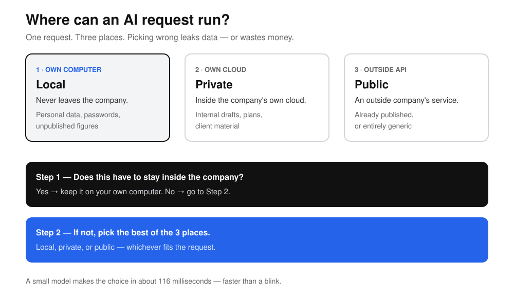
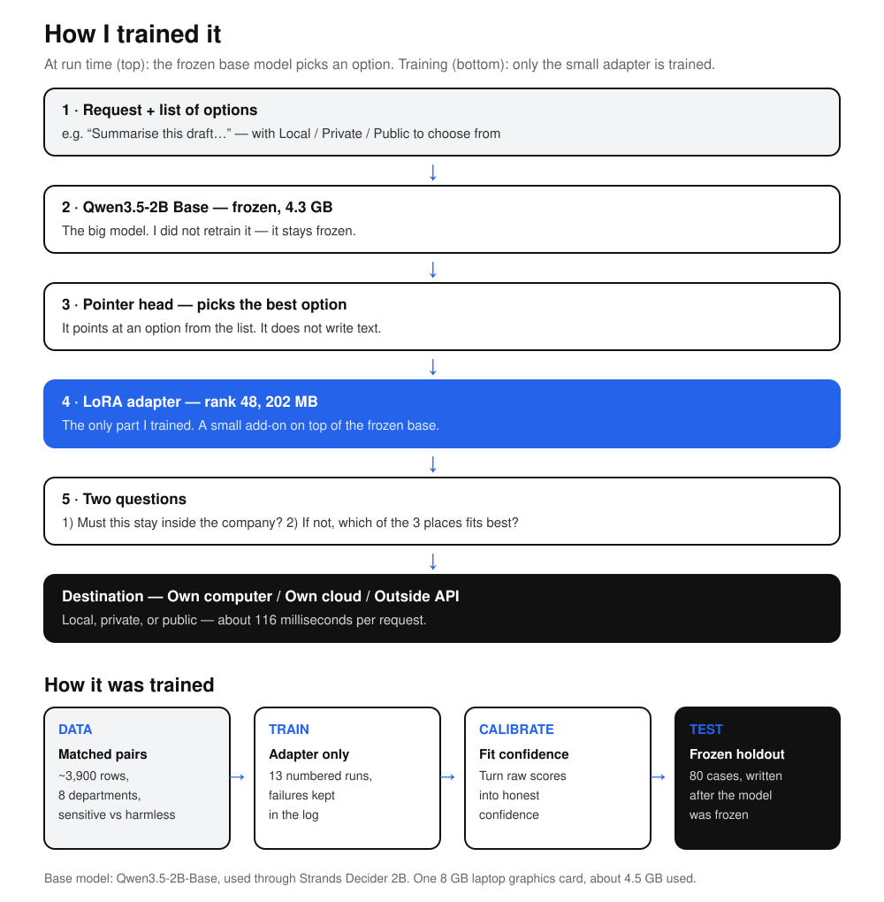
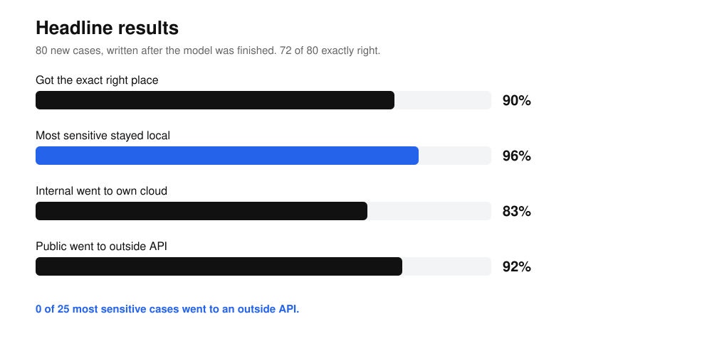

# Confidentiality-Aware Request Router

**A small decision model that decides where an AI request is allowed to run: on-prem, private cloud, or a public API — 90% exactly right, and 0 of 25 high-sensitivity requests sent outside.**

## Contents

- [At a glance](#at-a-glance)
- [The problem](#the-problem)
- [What I built](#what-i-built)
- [How I trained it](#how-i-trained-it)
- [Data and evaluation sets](#data-and-evaluation-sets)
- [Headline results](#headline-results)
- [The full story](#the-full-story)
- [What I did, vs what was open source](#what-i-did-vs-what-was-open-source)
- [Stack](#stack)
- [Talking points](#talking-points)
- [Files in this repo](#files-in-this-repo)
- [Licence](#licence)

## At a glance

| | |
|---|---|
| **Problem** | Every AI request has to land on one of three trust boundaries. Get it wrong one way and data leaks; get it wrong the other way and you burn money and capacity. |
| **Approach** | Fine-tune a 2B decision model — not an LLM, a classifier that scores options — into a two-question policy: a yes/no sensitivity guard, then a three-way destination choice. |
| **Headline result** | **90.0% exact destination (72/80), 96% of high-sensitivity kept local (24/25), 0 high-sensitivity to a public API** — on an 80-case holdout written *after* the model was frozen. |
| **Cost** | 1–2 forward passes, no text generation · 115.8 ms p50 / 126.6 ms p95 · ~4.5 GB VRAM · 202 MB adapter on a 4.3 GB base model. |
| **Honest caveat** | Calibration error 0.143 vs a 0.10 target, and 3 of 30 internal requests still reached the outside API. A strong filter with a human/policy backstop — not a guarantee. |
| **Status** | **Handed over to the team — they were happy with the results. Now being integrated into the company's harness for production use.** |

> **What makes it worth reading:** the model is the easy part. The work was building an evaluation harness honest enough to keep proving the project wrong, generating training data that generalises past its author's imagination, and recognising when the remaining gap was a *problem-framing* problem, not a training problem.

## The problem

A company running AI has three places to run it:

- **On-prem (local)** — the only place certain content is allowed to go.
- **Private cloud (AWS)** — fine for internal material, not for anything customer-facing.
- **Public API** — cheap, capable, and completely outside the company's control.

Today a human decides, or a regex list does. Neither scales. The classifier that should replace them has four awkward requirements:

1. **Cheap and fast** — it runs on *every* request, before the expensive model does.
2. **Calibrated** — a false "local" costs capacity, a missed "local" costs confidentiality.
3. **Not an LLM** — sending a request to an LLM to ask whether it is safe to send to an LLM is circular.
4. **Labels changeable without retraining** — the taxonomy was explicitly allowed to change while the surrounding services were still being chosen.

### The problem statement was wrong — and fixing it mattered most

The project started as a **six-route** router: formatting, coding, reasoning, image analysis, doc transformation, local. That taxonomy was dropped when it became clear the team's real requirement was a **trust boundary, not a task type**. The three-way framing — local / private / public — is what finally produced a defensible number, and made the leak metric directly measurable. Discovering that was worth more than any hyperparameter.

## What I built

A full adaptation loop around an open-source decision model, ending in a deployable service and a reproducible handover package: evaluation harness, synthetic data pipeline, thirteen numbered training runs, a decision policy with a single fitted threshold, and scripts that reproduce every published number.

**Step 1 — Does this have to stay inside the company?**
If yes, keep it on the company's own computer. No further question.

**Step 2 — If not, pick the best of the three places.**
Its own computer, its own cloud, or an outside API — whichever fits the request.

> Why not just ask a big AI model whether a request is safe? Because the request would have to be sent to that model first. A gate that leaks the thing it is gating is not a gate.

### The policy, in full

- **The guard is the safety control.** One fitted number in the whole policy — **0.70** — decides whether a request is forced on-prem. It sits a wide margin below the lowest high-sensitivity score ever observed (0.815).
- **The second question has no threshold.** Once a request is cleared, the three-way choice decides. A second threshold would be a second knob to fit and defend, and the data never justified one.
- **Two constants are coupled and must move together:** temperature 3.3178, fitted into the checkpoint config, and guard threshold 0.70, fitted against that temperature. Reset the temperature to 1.0 and the threshold is meaningless — the single easiest way to silently break the system.
- Worst case is two model calls; the common case for sensitive traffic is one.

## How I trained it

*The model at run time (top) and how it was trained (bottom). Full details in [PROJECT.md](PROJECT.md).*

### Which model

**Qwen3.5-2B-Base, used through Strands Decider 2B.** Its language-modelling head — the part that writes text — was removed and replaced with a **pointer head**. In plain words: instead of writing words, it points at the best option from a list. That is why it is fast, and why it cannot generate text.

One forward pass: the hidden state at the `<answer>` position is the query, the hidden state at the last token of each option is a key, scaled dot product, softmax, done.

Consequences that mattered:

- **No generation, no decoding loop.** Latency is one forward pass, not one token at a time.
- **No per-option parameters.** Nothing can learn "the first option is usually right", and there is no ceiling on how many options a question may carry — 2 to 255. Labels are defined *in the request*, so a taxonomy can change without retraining.
- **Confidence is derived, not predicted:** `confidence = (N·p_max − 1) / (N − 1)`, independent of N, so one threshold means the same thing for 3 options and 12.

### The adapter

**A rank-48 LoRA adapter (alpha 96, dropout 0.05) across 12 projection modules, plus the pointer head — 202 MB.** LoRA means the big 4.3 GB base model stays frozen, and I only train a small add-on on top of it. Training only the adapter is what made this possible on a single 8 GB laptop graphics card (RTX 4060 Laptop), using about 4.5 GB VRAM at serving, 4.7 GiB peak in training.

### How I did it

1. **Built the data myself — composition, not enumeration.** Matched sensitive / harmless pairs in the same words and domain — "fix the connection string in this config" vs "fix the indentation in this config" — so "mentions money" or "mentions a client" is never enough. About **3,900 rows from ~48 pairs × 12 verbs × 5 prefixes × 5 suffixes**, deduplicated to ~2,700 distinct phrasings, across **8 departments** (creative, finance, HR, legal, sales, ops, medical, engineering), in **3 payload shapes**: document nouns, field-level records (`first_name`, `dob`, `address`), and credential-shaped strings (`postgres://admin:…`, `Authorization: Bearer eyJ…`). Label names, descriptions, instruction wording, option count (6 or 16) and input format were varied per row, so the model could not bind to one vocabulary.
2. **Trained only the adapter, in 13 numbered runs — and kept the failures in the log.** See the journey below.
3. **Calibrated it.** A single temperature was fitted after training to turn raw scores into honest confidence — fitted, not guessed. A fine-tune destroys calibration: an earlier run needed temperature 6.0.
4. **Tested it honestly.** The headline 80-case holdout was written after the model was frozen, and fresh test sets were written by other generators, so memorisation could not inflate the score. Contamination was checked at ≥0.80 similarity against every prior dataset before any run — that check caught two contaminated runs that would otherwise have produced a flattering, meaningless number.

### The API

The runtime exposes the model as a small HTTP service, so the harness only sees a JSON contract: `POST /v1/systemone` with the request text and a `choice` question carrying `criteria` (label → description). A `choice` question takes `criteria`, not `options` — sending `options` returns HTTP 422. That distinction cost real time and is now the first line of the handover's gotcha list.

## Data and evaluation sets

### Labels

Each destination ships with a written definition the model sees, the same rubric a human would:

| Label | Definition used in the prompt |
|---|---|
| `local` | Must never leave the company — personal data about identified people, credentials, legal or medical matters, or unpublished financial figures. |
| `private` | Fine inside our own cloud (AWS) but not for an external model — internal drafts, plans, notes, client-specific material. |
| `public` | Safe to send to an external model — already published, or entirely generic. |

### Evaluation sets — nothing was judged on data it had been tuned against

| Set | Size | Role |
|---|---|---|
| **Frozen holdout** | 80 | **The number to quote.** 25 high, 30 some, 25 none; written by an independent generator after the model was frozen. Zero prompts matched training or any earlier test set at ≥0.80 similarity. |
| Tuned benchmark | 108 | 40 sensitive, 18 image, 10 long-document cases. Used repeatedly for selection, so **no longer a holdout** — regression check only. |
| Tuning set | 101 | Used to choose between designs and fit the 0.70 threshold. |
| Generated batch 1 | 50 | Written by a different generator to a brief; frozen, never trained on. |
| Blind test set | 50 | Written by an outside generator from a test-set brief; used to settle the gate-vs-router question. |
| Fresh generic set | 59 | Written after all tuning: 37 ordinary, 12 implicit-sensitive, 10 explicit. |
| Creative holdout | 270 | Disjoint creative-agency vocabulary; used for in-domain depth. |

## Headline results

Tested on **80 new cases, written after the model was finished** — so it could not have memorised them. 25 were most sensitive, 30 were internal, 25 were public.

- **90% got the exact right place** — 72 of 80.
- **96% of the most sensitive stayed on the company's own computer** — 24 of 25.
- **0 of the 25 most sensitive went to an outside API.** 1 high-tier case went to private cloud — still inside the company.
- **83% of internal cases went to the company's own cloud**, and **92% of public cases went outside**.
- **About 116 milliseconds per request** — p50 115.8 ms / p95 126.6 ms wall clock, model time 101.9 / 116.9 ms — on one ordinary 8 GB graphics card, using about 4.5 GB.

### Where the 8 errors went — every error was in the safe direction or adjacent to it

| Error | Count | Read |
|---|---|---|
| high → private | 1 | **The dangerous direction was empty.** The one high-tier miss stayed inside the company. |
| some → public | 3 | Internal drafts cleared for an external model — the boundary failing, not a leak. |
| some → local | 2 | Over-conservative; costs capacity, not confidentiality. |
| none → private/local | 2 | Over-conservative. |

### Try it in your head

| Request | Goes to | Why |
|---|---|---|
| "Explain why October revenue was £1.74m against the unpublished £1.96m forecast" | **Own computer** | Unpublished financial figures must never leave the company. |
| "Summarise the draft internal onboarding plan for new starters" | **Own cloud** | An internal draft — fine inside the company's own cloud, not for an outside service. |
| "Explain what a decision model does, in general" | **Outside API** | Entirely generic, already-published knowledge — safe to send outside. |

### What actually moved accuracy

| Intervention | Effect | Verdict |
|---|---|---|
| Upgrade the released model (v19 → v1) | +6.5 pts | **Not distinguishable** (McNemar p = 0.143) |
| Reword one option description | **+12 pts** | **Real** (p = 0.001) |
| Add vision to a text-tuned model | 8/8 images, incl. both sensitive ones | Real, with no image training |
| Rename labels, keep descriptions | −10 pts sensitivity | Real — the literal token "local" was doing work |
| Go from 6 to 24 options | −24 pts accuracy | Real — option count costs accuracy |
| Narrow the task from 6 routes to 3 destinations | Made the leak metric directly measurable; one threshold instead of a six-way argmax | Decisive for deployment, not for the benchmark |

**Better prompt text beat a better model** — and the only way to know that was to test both on the same cases with a paired test. Bare percentages would have let the model upgrade take credit for the prompt fix.

## The full story

The full 13-run experiment log, the binary-gate discovery, engineering, reproducibility, gotchas, limitations and the real-traffic testing protocol live in [training-journey.md](training-journey.md), [PROJECT.md](PROJECT.md) and [TESTING.md](TESTING.md) — not repeated here.

## What I did, vs what was open source

The base model and runtime are open source (Strands Decider 2B, built on Qwen3.5-2B-Base). This project is an **adaptation**, not a new architecture — and the interesting work is in the adaptation:

- designed and ran the **evaluation harness** (frozen holdouts, exact McNemar, bootstrap CIs, recall at a fixed false-positive budget, calibration, latency percentiles);
- built the **synthetic data pipeline** — matched pairs, eight departments, three payload shapes, vocabulary randomisation;
- ran **thirteen numbered training runs** on a single 8 GB GPU, including several that failed or were not promoted, and documented why;
- designed the **two-question decision policy** and fitted its single threshold;
- made the **reproducibility and handover package** — pinned runtime, checksums, reproduction scripts, model card, traffic-testing protocol.

## Stack

Python 3.12 · PyTorch 2.14 · transformers 5.20 · PEFT / LoRA · Qwen3.5-2B-Base · Strands Decider runtime (pinned commit) · HTTP serving + JSON API · Git LFS · SHA-256 artifact verification · exact McNemar / bootstrap CI / Wilson intervals · calibration (ECE, temperature scaling)

## Talking points

**"Why not just ask GPT-4 whether the request is safe?"**
Because the request would have to be sent to GPT-4 first. A gate that leaks the thing it is gating is not a gate.

**"Why a 2B model?"**
Small enough to retrain the whole recipe on one consumer GPU in hours, large enough to do the work, and cheap enough to run on every request. The project never hit a capacity wall — it hit a data wall, which is a different and more interesting problem.

**"Your number is only 90%. Is that good?"**
The metric that matters is zero high-sensitivity requests reaching a public API, and that held on the frozen holdout. 90% exact destination at ~116 ms, with every error in the safe direction, is a usable filter. Calling it 95% would have been easy and wrong.

**"What would you do differently?"**
Demand real, labelled traffic before run 1. I spent nine runs learning that synthetic vocabulary does not transfer, which two hundred real requests would have told me in a day.

## Files in this repo

| File | What it is |
|---|---|
| `README.md` | This showcase — the short version, with the full story below it |
| `PROJECT.md` | Full write-up: design, data, results, engineering, limitations |
| `report.md` | Key metrics, one table |
| `training-journey.md` | Complete experiment log — all 13 runs, including the failures |
| `TESTING.md` | How to test it on 50 real requests |
| `assets/` | The four diagrams in this README |
| `LICENSE` | Apache-2.0 |

> **Weights are not in this repo.** The trained 202 MB adapter, checkpoints, evaluation data and reproduction scripts are not published here. This repo is the write-up, evaluation and methodology.

## Licence

Apache-2.0. The base model is under its own licence.
