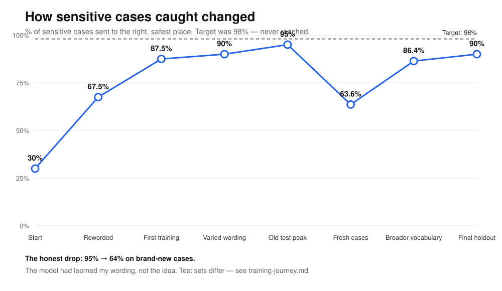

# Confidentiality-Aware Request Router

**A small decision model that decides where an AI request is allowed to run: on-prem, private cloud, or a public API — 90% exactly right, and 0 of 25 high-sensitivity requests sent outside.**

## At a glance

| | |
|---|---|
| **Problem** | Every AI request has to land on one of three trust boundaries. Get it wrong one way and data leaks; get it wrong the other way and you burn money and capacity. |
| **Approach** | Fine-tune a 2B decision model — not an LLM, a classifier that scores options — into a two-question policy: a yes/no sensitivity guard, then a three-way destination choice. |
| **Headline result** | **90.0% exact destination (72/80), 96% of high-sensitivity kept local (24/25), 0 high-sensitivity to a public API** — on an 80-case holdout written *after* the model was frozen. |
| **Cost** | 1–2 forward passes, no text generation · 115.8 ms p50 / 126.6 ms p95 · ~4.5 GB VRAM · 202 MB adapter on a 4.3 GB base model. |
| **Honest caveat** | Calibration error 0.143 vs a 0.10 target, and 3 of 30 internal requests still reached the outside API. A strong filter with a human/policy backstop — not a guarantee. |

> **What makes it worth reading:** the model is the easy part. The work was building an evaluation harness honest enough to keep proving the project wrong, generating training data that generalises past its author's imagination, and recognising when the remaining gap was a *problem-framing* problem, not a training problem.

## The problem

A company running AI has three places to run it:

- **On-prem (local)** — the only place certain content is allowed to go.
- **Private cloud (AWS)** — fine for internal material, not for anything customer-facing.
- **Public API** — cheap, capable, and completely outside the company's control.

Today a human decides, or a regex list does. Neither scales. The classifier that should replace them has four awkward requirements:

1. **Cheap and fast** — it runs on *every* request, before the expensive model does.
2. **Calibrated** — a false "local" costs capacity, a missed "local" costs confidentiality.
3. **Not an LLM** — sending a request to an LLM to ask whether it is safe to send to an LLM is circular.
4. **Labels changeable without retraining** — the taxonomy was explicitly allowed to change while the surrounding services were still being chosen.


### The problem statement was wrong — and fixing it mattered most

The project started as a **six-route** router: formatting, coding, reasoning, image analysis, doc transformation, local. That taxonomy was dropped when it became clear the team's real requirement was a **trust boundary, not a task type**. The three-way framing — local / private / public — is what finally produced a defensible number, and made the leak metric directly measurable. Discovering that was worth more than any hyperparameter.

## What I built

A full adaptation loop around an open-source decision model, ending in a deployable service and a reproducible handover package: evaluation harness, synthetic data pipeline, thirteen numbered training runs, a decision policy with a single fitted threshold, and scripts that reproduce every published number.

**Step 1 — Does this have to stay inside the company?**
If yes, keep it on the company's own computer. No further question.

**Step 2 — If not, pick the best of the three places.**
Its own computer, its own cloud, or an outside API — whichever fits the request.

> Why not just ask a big AI model whether a request is safe? Because the request would have to be sent to that model first. A gate that leaks the thing it is gating is not a gate.

### The policy, in full

```
p = model.noul(state, GUARD_QUESTION)
dest = "local" if p > 0.70 else model.choice(state, DESTINATION_QUESTION, criteria)
```

That is the entire deployment logic.

- **The guard is the safety control.** One fitted number in the whole policy — **0.70** — decides whether a request is forced on-prem. It sits a wide margin below the lowest high-sensitivity score ever observed (0.815).
- **The second question has no threshold.** Once a request is cleared, the three-way choice decides. A second threshold would be a second knob to fit and defend, and the data never justified one.
- **Two constants are coupled and must move together:** temperature 3.3178, fitted into the checkpoint config, and guard threshold 0.70, fitted against that temperature. Reset the temperature to 1.0 and the threshold is meaningless — the single easiest way to silently break the system.
- Worst case is two model calls; the common case for sensitive traffic is one.

## How I trained it


*The model at run time (top) and how it was trained (bottom). Full details in [PROJECT.md](PROJECT.md).*

### Which model

**Qwen3.5-2B-Base, used through Strands Decider 2B.** Its language-modelling head — the part that writes text — was removed and replaced with a **pointer head**. In plain words: instead of writing words, it points at the best option from a list. That is why it is fast, and why it cannot generate text.

One forward pass: the hidden state at the `<answer>` position is the query, the hidden state at the last token of each option is a key, scaled dot product, softmax, done.

Consequences that mattered:

- **No generation, no decoding loop.** Latency is one forward pass, not one token at a time.
- **No per-option parameters.** Nothing can learn "the first option is usually right", and there is no ceiling on how many options a question may carry — 2 to 255. Labels are defined *in the request*, so a taxonomy can change without retraining.
- **Confidence is derived, not predicted:** `confidence = (N·p_max − 1) / (N − 1)`, independent of N, so one threshold means the same thing for 3 options and 12.

### The adapter

**A rank-48 LoRA adapter (alpha 96, dropout 0.05) across 12 projection modules, plus the pointer head — 202 MB.** LoRA means the big 4.3 GB base model stays frozen, and I only train a small add-on on top of it. Training only the adapter is what made this possible on a single 8 GB laptop graphics card (RTX 4060 Laptop), using about 4.5 GB VRAM at serving, 4.7 GiB peak in training.

### How I did it

1. **Built the data myself — composition, not enumeration.** Matched sensitive / harmless pairs in the same words and domain — "fix the connection string in this config" vs "fix the indentation in this config" — so "mentions money" or "mentions a client" is never enough. About **3,900 rows from ~48 pairs × 12 verbs × 5 prefixes × 5 suffixes**, deduplicated to ~2,700 distinct phrasings, across **8 departments** (creative, finance, HR, legal, sales, ops, medical, engineering), in **3 payload shapes**: document nouns, field-level records (`first_name`, `dob`, `address`), and credential-shaped strings (`postgres://admin:…`, `Authorization: Bearer eyJ…`). Label names, descriptions, instruction wording, option count (6 or 16) and input format were varied per row, so the model could not bind to one vocabulary.
2. **Trained only the adapter, in 13 numbered runs — and kept the failures in the log.** See the journey below.
3. **Calibrated it.** A single temperature was fitted after training to turn raw scores into honest confidence — fitted, not guessed. A fine-tune destroys calibration: an earlier run needed temperature 6.0.
4. **Tested it honestly.** The headline 80-case holdout was written after the model was frozen, and fresh test sets were written by other generators, so memorisation could not inflate the score. Contamination was checked at ≥0.80 similarity against every prior dataset before any run — that check caught two contaminated runs that would otherwise have produced a flattering, meaningless number.

### The API

The runtime exposes the model as a small HTTP service, so the harness only sees a JSON contract: `POST /v1/systemone` with the request text and a `choice` question carrying `criteria` (label → description). A `choice` question takes `criteria`, not `options` — sending `options` returns HTTP 422. That distinction cost real time and is now the first line of the handover's gotcha list.

## Data — labels and evaluation sets

### Labels

Each destination ships with a written definition the model sees, the same rubric a human would:

| Label | Definition used in the prompt |
|---|---|
| `local` | Must never leave the company — personal data about identified people, credentials, legal or medical matters, or unpublished financial figures. |
| `private` | Fine inside our own cloud (AWS) but not for an external model — internal drafts, plans, notes, client-specific material. |
| `public` | Safe to send to an external model — already published, or entirely generic. |

### Evaluation sets — nothing was judged on data it had been tuned against

| Set | Size | Role |
|---|---|---|
| **Frozen holdout** | 80 | **The number to quote.** 25 high, 30 some, 25 none; written by an independent generator after the model was frozen. Zero prompts matched training or any earlier test set at ≥0.80 similarity. |
| Tuned benchmark | 108 | 40 sensitive, 18 image, 10 long-document cases. Used repeatedly for selection, so **no longer a holdout** — regression check only. |
| Tuning set | 101 | Used to choose between designs and fit the 0.70 threshold. |
| Generated batch 1 | 50 | Written by a different generator to a brief; frozen, never trained on. |
| Blind test set | 50 | Written by an outside generator from a test-set brief; used to settle the gate-vs-router question. |
| Fresh generic set | 59 | Written after all tuning: 37 ordinary, 12 implicit-sensitive, 10 explicit. |
| Creative holdout | 270 | Disjoint creative-agency vocabulary; used for in-domain depth. |

## Headline results


Tested on **80 new cases, written after the model was finished** — so it could not have memorised them. 25 were most sensitive, 30 were internal, 25 were public.

- **90% got the exact right place** — 72 of 80.
- **96% of the most sensitive stayed on the company's own computer** — 24 of 25.
- **0 of the 25 most sensitive went to an outside API.** 1 high-tier case went to private cloud — still inside the company.
- **83% of internal cases went to the company's own cloud**, and **92% of public cases went outside**.
- **About 116 milliseconds per request** — p50 115.8 ms / p95 126.6 ms wall clock, model time 101.9 / 116.9 ms — on one ordinary 8 GB graphics card, using about 4.5 GB.

### Where the 8 errors went — every error was in the safe direction or adjacent to it

| Error | Count | Read |
|---|---|---|
| high → private | 1 | **The dangerous direction was empty.** The one high-tier miss stayed inside the company. |
| some → public | 3 | Internal drafts cleared for an external model — the boundary failing, not a leak. |
| some → local | 2 | Over-conservative; costs capacity, not confidentiality. |
| none → private/local | 2 | Over-conservative. |

### Try it in your head

| Request | Goes to | Why |
|---|---|---|
| "Explain why October revenue was £1.74m against the unpublished £1.96m forecast" | **Own computer** | Unpublished financial figures must never leave the company. |
| "Summarise the draft internal onboarding plan for new starters" | **Own cloud** | An internal draft — fine inside the company's own cloud, not for an outside service. |
| "Explain what a decision model does, in general" | **Outside API** | Entirely generic, already-published knowledge — safe to send outside. |

### What actually moved accuracy

| Intervention | Effect | Verdict |
|---|---|---|
| Upgrade the released model (v19 → v1) | +6.5 pts | **Not distinguishable** (McNemar p = 0.143) |
| Reword one option description | **+12 pts** | **Real** (p = 0.001) |
| Add vision to a text-tuned model | 8/8 images, incl. both sensitive ones | Real, with no image training |
| Rename labels, keep descriptions | −10 pts sensitivity | Real — the literal token "local" was doing work |
| Go from 6 to 24 options | −24 pts accuracy | Real — option count costs accuracy |
| Narrow the task from 6 routes to 3 destinations | Made the leak metric directly measurable; one threshold instead of a six-way argmax | Decisive for deployment, not for the benchmark |

**Better prompt text beat a better model** — and the only way to know that was to test both on the same cases with a paired test. Bare percentages would have let the model upgrade take credit for the prompt fix.

## The training journey

This is the part I am proudest of — not the final number, but how honestly it was earned. Full 13-run log: [training-journey.md](training-journey.md).


*Chart points come from different test sets — 108-case benchmark, then the 59-case fresh set, then the creative holdout — so read it as a story, not one smooth test. Each bullet below names its test.*

- **E1–E4, no training yet: started at 30%.** The off-the-shelf v19 caught 30% of sensitive cases (12/40) on the 108-case test. v1 lifted that to 35%. Rewording the option descriptions lifted it to 67.5% and overall to 86.1% — with vision, 8/8 images including both sensitive ones.
- **T0 failed, T0b passed.** A smoke run at `max_length` 128 failed — the option descriptions are ~700 characters, so 128 tokens truncates the option list. At 384 it passed.
- **T1 / Run 1: learned sensitivity, forgot other jobs.** Sensitivity 67.5% → 87.5% (+20 pts, implicit 18/30 → 25/30), but ordinary traffic 97.1% → **41.2%**. The training rows only ever contained `local`, `formatting` and `doc-transformation` — the model forgot the three labels it never saw. Loss 0.616 → 0.0000 and val_acc 1.0 meant memorisation, not learning.
- **T2 / Run 2: the standard fix did not fit.** A KL anchor against forgetting stalled at 0 optimizer steps in ~20 minutes, VRAM pinned at 7,931/8,188 MiB. Balanced data replaced it.
- **Label-adaptation test: it adapts, but it is not free.** Renaming the six labels cost ~10 pts of sensitivity (67.5% → 57.5%). Fixing the instruction to match the new name made it *worse* (→ 47.5%) — the literal token "local" is load-bearing. 6 → 12 options cost ~6 pts, 12 → 24 cost another ~11 pts (86.1% → 73.1% → 62.0%).
- **Run 3: multi-taxonomy training — the one that worked.** 1,020 rows balanced across all six classes, varying label names, descriptions, instruction wording, option count (6 or 16) and input format, plus `max_length` raised from 384 to 4096. Overall 86.1% → **95.4%**, ordinary 98.5%, sensitivity 90.0% (36/40). Renaming now cost nothing (95.4% either way), 12 options as good as 6. At `max_length` 384 the same checkpoint scored 86.1% — the prompt was being truncated through the option list, so that result was invalid, not merely lower.
- **Run 4: targeted fixes, error moved not shrank.** Added 72 targeted rows for the two remaining failures (connection string, phone extensions). Overall 98.1%, ordinary 100%, sensitivity 95.0% — but it fixed one case and broke another (employee performance review). At ~1,100 rows, diminishing returns on that failure mode.
- **The honest drop: 95% → 64% on brand-new cases.** On the 108-case benchmark Run 4 scored 95% sensitivity (98.1% overall). On 59 brand-new cases it scored **63.6% sensitivity, 41.7% implicit**. Every implicit miss hinged on a noun never in training: SOC2 evidence, salary benchmarking, disciplinary hearing, redundancy consultation, credit committee, clinic appointments. **It had learned my vocabulary, not the concept.**
- **Run 5: creative-agency vocabulary.** 2,500 rows from ~30 sensitive payloads in a creative agency's real vocabulary, each paired with a harmless lookalike. Fresh sensitivity 63.6% → **86.4%**, implicit 41.7% → 75.0%, ordinary unchanged at 91.9%. Creative holdout sensitive 78.3%, harmless 98.7%.
- **Run 6: eight departments.** 3,900 rows, composition instead of enumeration. Creative holdout sensitive 78.3% → **90.0%**, harmless 100%, calibration ECE 0.089 → 0.044. Generic fresh sensitivity flat at 86.4% — in-domain win, cross-domain flat. Further synthesis was buying in-domain gains, not general ones.
- **Run 7: short imperatives, and a small-sample trap.** 700 deliberately terse rows. Fresh sensitivity 86.4% → **100% (22/22)** — but on the larger creative holdout 90.0% → 88.3%, and ordinary fell to 86.5%. With n=22, one case is 4.5 points; 22/22 has a confidence interval down to ~85%. Run 6 stays the model to ship.
- **Run 8: generated data as a garnish made it worse.** Adding 150 externally generated rows on top of Run 6 dropped sensitivity 84.6% → **61.5%** on the frozen generated batch. Generated data has to be the basis of a run, not a top-up.
- **Run 9: the trade-off, measured from both sides.** Trained fresh from v1 on 308 generated rows + synthetic top-ups (758 rows, 41% generated). Sensitivity 92.3% but ordinary **67.6%** — it buys 7.7 pts of sensitivity for 27 pts of ordinary accuracy. Sensitivity and routing capacity trade against each other; no setting reaches both.
- **The ceiling, measured three ways:** thresholding bought +4.5 pts then collapsed to sending everything local; Runs 5–7 sat at 86–90% regardless of volume; an independent generator reproduced the same 85–90% band (84.6% sensitivity on its 50 prompts). The honest deliverable is a **choice of operating point on a measured curve**, not a model that meets the 98% spec.

### The binary gate — the best sensitivity in the project, and why it was not shipped as the whole answer

- **Embeddings failed:** a 1,342-prompt embedding bank scored AUC ~0.66 vs the model's ~0.96. Same-domain, same-verb lookalikes cannot be separated by word similarity. 20 minutes to rule out.
- **The binary gate worked:** asking the same Run 6 checkpoint a yes/no question — "should this be handled where data never leaves the company?" — instead of a 6-way choice gave **AUC 0.962 pooled (n=379, 155 sensitive), 93.5% recall at a 5% false-positive budget**. A binary question is a much easier task than a 6-way choice.
- **Gate OR router: 94.3% sensitivity, 8.1% false positives** — only 2 of 35 sensitive cases missed by both. That is the best sensitivity achieved anywhere, using one model asking two questions, no new dependency, no extra training.
- **Then the blind test decided it:** on a fresh 50-case set written by an outside generator (23 sensitive), realistic sensitivity was **82.6%**, not 92–95%. The gate achieved that at 7.4% false positives; the router achieved the same recall at 18.5%. The two-question union added exactly zero here. **The gate should own sensitivity alone; the router is only worth running afterwards on cleared traffic.** Four cases defeat everything — board compensation resolutions, server access failure logs, a DAM asset-manifest script, a badge-scan log — bland internal artefacts with no overt marker. That is where the remaining ~17% lives.
- A fine-tuned binary adapter was tried too: worse pooled (AUC 0.904 vs 0.962), better on the externally generated set (15.4% → 92.3% at the same false-positive budget). **Neither gate was promoted** — the deciding evidence is more realistic data, not more tuning.

## Engineering

### Performance

| | |
|---|---|
| Model calls per request | 1 (guard fires) or 2 |
| Latency p50 / p95 | 115.8 / 126.6 ms wall clock |
| Model time p50 / p95 | 101.9 / 116.9 ms |
| VRAM, serving | ~4.5 GB (6 GB card minimum) |
| Adapter size | 202 MB (vs 4.3 GB base, downloaded once) |
| Trainable | LoRA adapter + pointer head only; base frozen |

This is a gate that runs on **every** request for ~100 ms on a single consumer GPU, and its answer is a probability a policy can reason about. An LLM call for the same decision would be two orders of magnitude more expensive and would still not give a calibrated number.

### Reproducibility

- **Runtime pinned by commit** (`b81d443c07438dc5ed51d0e85f9db184ad65d809`), not version — a newer runtime changes temperature handling, prompt assembly and option tokenisation.
- **Dependencies pinned exactly:** Python 3.12, torch 2.14.1, transformers 5.20.2, peft 0.21.2, datasets 5.1.0; transformers below 5.18 silently breaks image input.
- **Weights under Git LFS** with SHA-256 checksums, verified on every machine move.
- **Scripts that reproduce every published number** (`holdout_eval.py`, `three_way_eval.py`, `gate_on_set.py`, `operating_point.py`, `latency_gate.py`, `compare.py`, `stratify.py`).
- Reproducing the headline takes four commands — clone the runtime, pin the commit, download Qwen3.5-2B-Base once, serve `checkpoints/run13`, run `tools/holdout_eval.py` — and expects **72/80 = 90.0%, sensitive → public = 0**. A mismatch means the *environment* differs, not the data.

### Hard-won gotchas

| Gotcha | Why it bites |
|---|---|
| `max_length: 384` for training, `4096` at serving | The option list dominates the prompt. A prompt truncated through the option list is an *invalid* measurement, not merely a lower one. |
| `init_from` resets temperature to 1.0 | Silently decouples the guard threshold from the scores it was fitted on. |
| `choice` takes `criteria`, not `options` | HTTP 422, easy to misread as a server bug. |
| `val_acc 1.0` / `loss 0.0000` | Means memorisation, not learning. Never trust the training split. |
| A fine-tune destroys calibration | An earlier run needed temperature 6.0. Always recalibrate before quoting a confidence or a threshold. |
| Inputs over 4,096 tokens are unservable | Long documents must be chunked upstream — a scope decision, not a training one. Nine of 35 evaluation rows exceeded the window, up to 11,378 tokens. |

## What did not work

- **Sentence embeddings.** AUC ≈ 0.66 against the model's 0.96. Structural reason: hard negatives are same-domain, same-verb lookalikes.
- **A KL anchor against catastrophic forgetting.** Does not fit in 8 GB — zero optimizer steps in twenty minutes, VRAM pinned at 7,931/8,188 MiB. Balanced data replaced it.
- **Training on generated data as a garnish.** Adding 150 externally generated rows on top of a saturated checkpoint *reduced* sensitivity from 84.6% to 61.5%.
- **Targeted fixes that move the error.** Run 4 fixed one failure family and broke another — diminishing returns at ~1,100 rows.
- **Threshold tuning as a fix.** Sweeping the `local` bar bought +4.5 pts, then collapsed. No operating point reaches 98% with usable routing.

## Limitations

Stated plainly — a project that only reports wins is not reporting.

- **Calibration is 0.143, above the 0.10 target.** A fitted temperature pulled it to 0.115 but was rejected: it still missed the target and added a fitted parameter. A guard score of 0.99 means "highly likely", not "99% sure".
- **Zero observed leaks is not zero risk.** 0 of 25 with a 95% upper bound of about 11% is consistent with a small real leak rate. The system needs a human or policy backstop.
- **The internal boundary leaks about one request in ten.** 3 of the 30 `private`-tier cases reached the external API. The high-sensitivity boundary held; the internal one did not, and that is the boundary the company actually cares about day to day.
- **It answers two questions.** Unseen wordings produce arbitrary, occasionally inverted answers. It is narrowly tuned, not general — new questions require retraining and measurement.
- **Long documents (over 4,096 tokens) are out of scope.** They must be chunked upstream.
- **All evaluation data is synthetic.** The 90% is measured on generated requests. The handover's first ask is for 50 real ones, because that is the only way the number becomes trustworthy.
- **90% ± sampling error.** On 80 cases the 95% interval is roughly 80–94%.

## Testing it on real traffic — the next step

Full protocol in [TESTING.md](TESTING.md). In short: collect **50 real requests**, hand-label each one local / private / public, run them through the model, record both answers. About an hour.

What matters most is not the overall number, but the **errors, in this order**: sensitive → public (a real leak), sensitive → private (policy violation, contained), internal → public (the boundary failing).

Where it already fails: bland internal documents with no marker — "board compensation resolution clauses", "server access failure log", "script template fetching DAM asset manifests", "badge scan log, late night entries". If your traffic has a different flavour of that, those rows are the most valuable you can give.

Do not filter the sample to make it look good, and do not paste anything genuinely confidential — describe it instead.

## If I continued

1. **Collect 50–200 real requests** per department and hand-label them. Every previous round showed real vocabulary beats more synthesis; this is the only lever with a proven effect left.
2. **Run the two-question policy as a shadow mode** for a month — log the decision and the human override, never block — and measure the override rate per department.
3. **Add a "why" field to the error log** so misses are tagged by failure family (bland internal artefact, ambiguous label, long input) instead of being counted as one accuracy number.
4. **Chunk-and-route for long documents**, so the 4,096-token wall stops being a silent exclusion.
5. **Per-department adapters on one shared base**, if the shadow data shows vocabularies really do diverge — the pointer head makes this cheap to try and cheap to reverse.

## What I did, vs what was open source

The base model and runtime are open source (Strands Decider 2B, built on Qwen3.5-2B-Base). This project is an **adaptation**, not a new architecture — and the interesting work is in the adaptation:

- designed and ran the **evaluation harness** (frozen holdouts, exact McNemar, bootstrap CIs, recall at a fixed false-positive budget, calibration, latency percentiles);
- built the **synthetic data pipeline** — matched pairs, eight departments, three payload shapes, vocabulary randomisation;
- ran **thirteen numbered training runs** on a single 8 GB GPU, including several that failed or were not promoted, and documented why;
- designed the **two-question decision policy** and fitted its single threshold;
- made the **reproducibility and handover package** — pinned runtime, checksums, reproduction scripts, model card, traffic-testing protocol.

## Stack

Python 3.12 · PyTorch 2.14 · transformers 5.20 · PEFT / LoRA · Qwen3.5-2B-Base · Strands Decider runtime (pinned commit) · HTTP serving + JSON API · Git LFS · SHA-256 artifact verification · exact McNemar / bootstrap CI / Wilson intervals · calibration (ECE, temperature scaling)

## Talking points

**"Why not just ask GPT-4 whether the request is safe?"**
Because the request would have to be sent to GPT-4 first. A gate that leaks the thing it is gating is not a gate.

**"Why a 2B model?"**
Small enough to retrain the whole recipe on one consumer GPU in hours, large enough to do the work, and cheap enough to run on every request. The project never hit a capacity wall — it hit a data wall, which is a different and more interesting problem.

**"Your number is only 90%. Is that good?"**
The metric that matters is zero high-sensitivity requests reaching a public API, and that held on the frozen holdout. 90% exact destination at ~116 ms, with every error in the safe direction, is a usable filter. Calling it 95% would have been easy and wrong.

**"What would you do differently?"**
Demand real, labelled traffic before run 1. I spent nine runs learning that synthetic vocabulary does not transfer, which two hundred real requests would have told me in a day.

## Files in this repo

| File | What it is |
|---|---|
| `README.md` | This showcase — the short version, with the full story below it |
| `PROJECT.md` | Full write-up: design, data, results, engineering, limitations |
| `report.md` | Key metrics, one table |
| `training-journey.md` | Complete experiment log — all 13 runs, including the failures |
| `TESTING.md` | How to test it on 50 real requests |
| `assets/` | The four diagrams in this README |
| `LICENSE` | Apache-2.0 |

> **Weights are not in this repo.** The trained 202 MB adapter, checkpoints, evaluation data and reproduction scripts are not published here. This repo is the write-up, evaluation and methodology.

## Licence

Apache-2.0. The base model is under its own licence.
